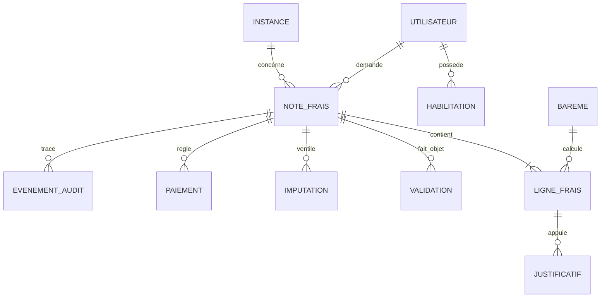

# Fiche de frais — UR CFTC Bretagne

**Projet open source en cours de cadrage et de développement — aucune version exploitable à ce stade.**

Application de dématérialisation des notes de frais pour les mandatés, élus et personnes habilitées de l'Union régionale CFTC Bretagne. L'objectif est de fiabiliser la saisie des frais, leur calcul, la conservation des justificatifs, la validation, le paiement et la ventilation analytique **AGFPN / URB**.

## Fonctionnalités prévues

- **Saisie** : fiche individuelle, motif, réunion ou mandat, identité et code INARIC, lignes de dépenses, itinéraires multi-étapes et covoiturage.
- **Calculs** : indemnités kilométriques, plafonds, frais d'approche, barèmes historiques et règles propres au type de réunion.
- **Justificatifs** : pièces Drive, convocations, présence, frais de transport, repas et hébergement.
- **Workflow** : brouillon, soumission, contrôle, correction, validation, paiement et archivage, avec piste d'audit.
- **Comptabilité analytique** : ventilation des dépenses en AGFPN, URB ou mixte, contrôles d'équilibre, suivi des écritures, exports et rapprochement.
- **Administration et reporting** : référentiels, habilitations, tableaux de bord, exports et sauvegardes.

## Référentiel de travail : fiche UR du 27 avril 2026

Les valeurs suivantes proviennent de la fiche UR et **nécessitent validation formelle avant toute utilisation en production**.

| Poste | Règle figurant dans la fiche |
| --- | --- |
| Train | Seconde classe, sur justificatif |
| Voiture — réunion collective, plus de 2 personnes | 0,50 €/km |
| Voiture — réunion collective, 2 personnes | 0,45 €/km |
| Voiture — réunion collective, conducteur seul | 0,40 €/km, plafond indiqué de 135 € |
| Voiture — réunion paritaire régionale / bureau | 0,50 €/km |
| Hôtel individuel avec petit déjeuner | Jusqu'à 80 €, sur justificatif |
| Frais d'approche des covoiturés | 0,40 €/km au-delà de 10 km, modalités à préciser |

**Contradiction documentaire à arbitrer :** les cases du formulaire indiquent déjeuner 25 € / dîner de la veille 30 €, tandis que les consignes indiquent déjeuner 20 € / dîner 25 €. **Aucune valeur ne doit être codée comme définitive avant décision écrite du trésorier.**

Les réunions remboursées par un organisme extérieur ne doivent pas donner lieu à un double remboursement UR. Le respect des conditions de convocation et de présence doit être contrôlé.

## Architecture cible et socle en développement

- Monolithe modulaire en **TypeScript**, compilé pour **Google Apps Script**, avec **clasp** et GitHub.
- Interface HTML/CSS/JavaScript ; couche métier indépendante de Google Sheets.
- Adaptateurs **Google Sheets** (stockage initial), **Drive** (pièces et PDF), **Gmail** (notifications), éventuellement Agenda Google et MandatScop.
- Versionnement des règles et barèmes, journalisation des actions, idempotence des paiements et tests automatisés.
- Gestion stricte des accès et des secrets ; possibilité ultérieure de remplacer le stockage.

Un socle TypeScript, des adaptateurs expérimentaux et des tests existent désormais. **Aucune application déployée ni utilisable en production n'est disponible.**

## Modèle de données

Le modèle distingue **le noyau actuellement codé (prototype V1)** et **le modèle métier cible (à implémenter et à valider)**. Les noms ci-dessous sont des contrats logiques : ils ne signifient pas que toutes les tables Google Sheets, relations ou API existent déjà.

### Schéma relationnel métier cible

### Entités principales

| Entité / référentiel | Attributs principaux | Rôle et contraintes |
| --- | --- | --- |
| `UTILISATEUR` | `id`, `subject` (identité serveur), `actif` | Identifiant interne stable ; données personnelles et INARIC dans un référentiel privé si nécessaires. Pas d'identifiant ou de rôle fiable provenant du client. |
| `HABILITATION` | `id`, `utilisateurId`, `role`, `perimetre`, `actif`, `dateDebut`, `dateFin` | Rôles `CLAIMANT`, `REVIEWER`, `FINANCE`, `TREASURER`, `ADMIN`, `AUDITOR` ; révocation et moindre privilège. |
| `INSTANCE` | `id`, `type`, `organisme`, `libelle` | Mandat, réunion, activité ou instance paritaire ; nomenclature à valider. |
| `NOTE_FRAIS` | `id`, `claimantId`, `instanceId?`, `fiscalYear`, `purpose`, `status`, `createdAt`, `version`* | Dossier unique rattaché au demandeur ; cycle de vie contrôlé, version pour concurrence optimiste. |
| `LIGNE_FRAIS` | `id`, `reportId`, `kind`, `description`, `amountCents`, `incurredOn`, `baremeId?` | Montants en **centimes entiers** ; catégories `TRAVEL`, `MEAL`, `ACCOMMODATION`, `OTHER`. Distinction montant demandé / retenu à ajouter. |
| `JUSTIFICATIF` | `id`, `lineId?`, `reportId`, `type`, `privateFileRef`, `checksum`, `uploadedAt` | Métadonnées uniquement dans la base ; fichiers dans un espace privé avec contrôle d'accès et durée de conservation. |
| `BAREME` | `id`, `categorie`, `valeur`, `unite`, `dateEffet`, `dateFin`, `statutValidation` | Versionnable, sans modification rétroactive ; barèmes repas contradictoires **non arbitrés**. |
| `VALIDATION` | `id`, `reportId`, `actorId`, `decision`, `commentaire`, `decidedAt` | Historique immuable des contrôles, demandes de correction et décisions. |
| `IMPUTATION` | `id`, `reportId`, `source`, `amountCents`, `eligibilityDecision` | `source ∈ {AGFPN, URB}` ; somme des affectations = montant retenu ; éligibilité AGFPN évaluée séparément. |
| `PAIEMENT` | `id`, `reportId`, `amountCents`, `mode`, `reference`, `paidAt`, `status` | Éviter les doubles paiements ; état et référence rapprochables avec la comptabilité. |
| `EVENEMENT_AUDIT` | `id`, `reportId`, `actorId`, `action`, `occurredAt`, `metadata` | Journal append-only et non sensible ; traçabilité des transitions et modifications. |

*L'astérisque signale notamment les champs prévus mais absents des interfaces TypeScript actuelles.*

### Relations et règles d'intégrité

- Un utilisateur peut posséder plusieurs habilitations et déposer plusieurs notes ; **chaque note possède un demandeur unique**.
- Une note comprend une ou plusieurs lignes lorsqu'elle est soumise ; un brouillon peut encore être vide. Les justificatifs requis dépendent de la nature de la dépense.
- Les liens `reportId`, `lineId`, `claimantId` et autres références sont contrôlés par le service métier ; **ne pas supposer de clés étrangères natives dans Google Sheets**.
- `amountCents` est un entier non négatif ; les sommes, plafonds et arrondis sont définis par des règles métier testées et versionnées.
- Les imputations AGFPN et URB doivent équilibrer le montant retenu, **sans présumer de l'éligibilité AGFPN**.
- Toute transition de statut, modification significative ou décision de paiement doit être autorisée, horodatée et auditée. Les écritures sensibles nécessitent une protection contre la concurrence.
- Les justificatifs, coordonnées bancaires et données d'appartenance syndicale restent **hors du dépôt public**, accessibles uniquement selon les habilitations et durées de conservation validées.

### Périmètre effectivement implémenté

Les interfaces [`ExpenseReport`](src/domain/entities/expense-report.ts) et [`ExpenseLine`](src/domain/entities/expense-line.ts) sont présentes, ainsi que le [contrôle d'équilibre des imputations](src/domain/services/allocation.ts) et des [types de rôles](src/application/ports/actor.ts). Le dépôt Google Sheets actuel ne persiste que les **brouillons `ExpenseReport`** : onglet `ExpenseReports`, colonnes `ID`, `CLAIMANT_ID_JSON`, `FISCAL_YEAR`, `PURPOSE_JSON`, `STATUS`, `CREATED_AT_JSON`, avec la version de schéma **1** dans `_SchemaMeta` (`EXPENSE_REPORT_SCHEMA_VERSION`).

La persistance des lignes, justificatifs, validations, imputations, paiements et audits, les migrations complètes et le modèle physique cible **restent à développer**. Toute évolution du schéma requiert une migration versionnée, des tests, une sauvegarde et une procédure de retour arrière. Voir [ADR-0003](docs/adr/0003-versionnement-sheets.md) et [principes d'architecture](docs/architecture/principes-maintenance.md).

## Gouvernance et backlog

Les spécifications et décisions à valider sont documentées dans le [cahier des charges et plan de projet](https://docs.google.com/document/d/1qKlhH18YekopYN6T-esXCYpDXYtXYtZOybeKINd2mDk/edit). Le [backlog GitHub Issues](https://github.com/UR-CFTC-Bretagne/fiche-de-frais/issues) décline les 10 epics et les User Stories **US-001 à US-075**. Les 65 premières sont définies au niveau de thèmes dans le cahier des charges ; leur découpage détaillé reste une **proposition à affiner lors du refinement**. Les US-066 à US-075 reprennent l'addendum fondé sur la fiche UR.

La feuille de route provisoire couvre le cadrage (sprint 0), le socle technique, la saisie/barèmes, les justificatifs et l'analytique, les validations, les paiements/reportings puis la recette et la sécurité. Dates, responsables et priorités sont à confirmer.

## Intégration et livraison continues

Chaque push sur `main` déclenche les contrôles de qualité et la [livraison continue d'un artefact de recette](.github/workflows/continuous-delivery.yml). Les archives de code compilé sont conservées 14 jours dans GitHub Actions, accompagnées d'une empreinte SHA-256 et de la révision source.

**La publication automatique de l'application n'est pas encore activée** : ce socle compilé n'est pas un bundle Google Apps Script déployable. La [procédure et les prérequis](docs/deployment/livraison-continue.md) définissent les étapes de sécurité nécessaires avant un déploiement réel. Le [contrôle manuel préalable](.github/workflows/production-gate.yml) n'effectue aucune publication.

## Sécurité et RGPD

**Ce dépôt est public.** Ne jamais y committer de données de frais réelles, justificatifs, identité de mandaté, code INARIC personnel, RIB, secrets, jetons ou clés d'API. Les notes de frais peuvent révéler une appartenance syndicale. Il faudra faire valider les habilitations, la confidentialité, l'hébergement et les durées de conservation avant tout pilote.

## Licence et attribution

Copyright © 2026 **Union régionale CFTC Bretagne**. Consulter [NOTICE](NOTICE).

L'**Apache License 2.0** a été proposée pour permettre la réutilisation avec conservation des mentions de droits d'auteur et notices lors des redistributions. La licence **n'est pas encore adoptée** et aucun fichier `LICENSE` n'est présent à ce stade. Tant que la licence et la titularité des droits ne sont pas validées, ce dépôt public ne constitue pas une autorisation générale de réutilisation du code.
